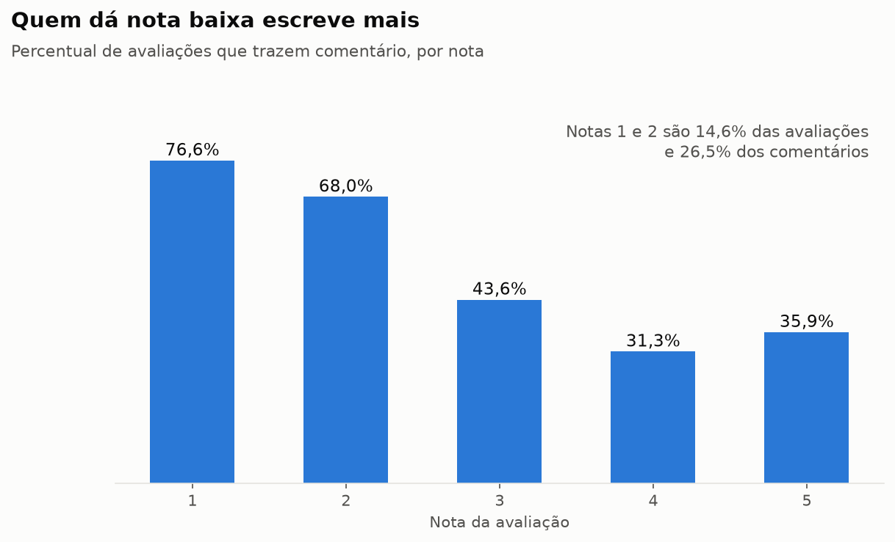
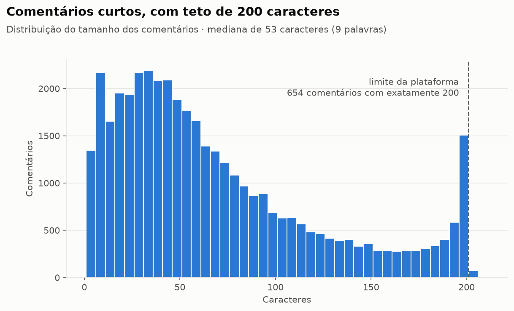
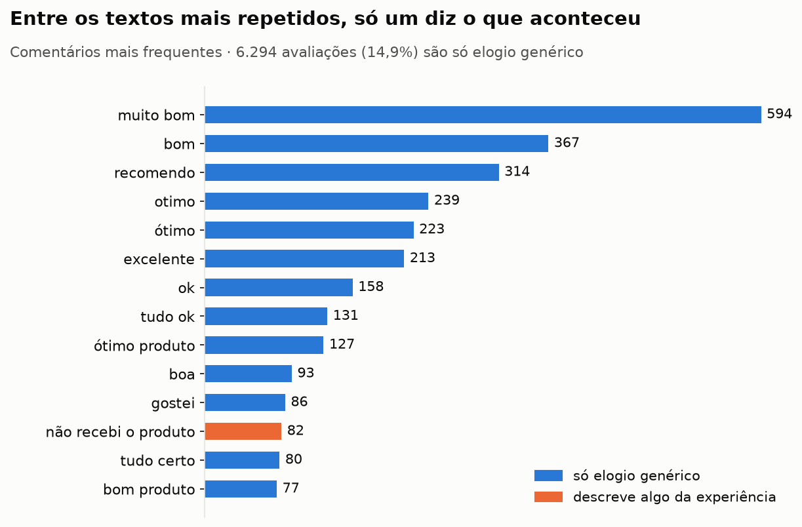
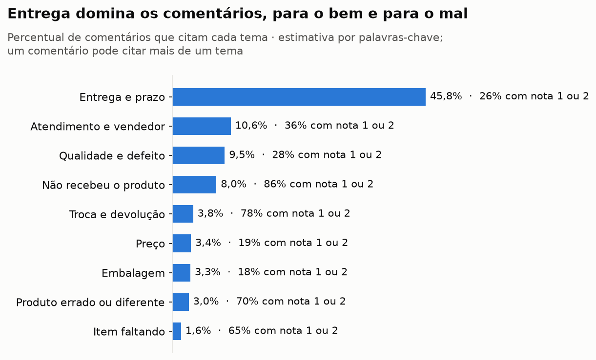

# Análise exploratória das avaliações

Percurso completo em [`notebooks/01_analise_exploratoria.ipynb`](../notebooks/01_analise_exploratoria.ipynb).
Números em [`analise_exploratoria.json`](analise_exploratoria.json), gerados por
`python -m src.preparacao.exploracao`.

## Volume

| | Avaliações |
|---|---|
| Linhas no arquivo | 99.224 |
| `review_id` únicos | 98.410 |
| Com comentário | 40.668 (41,3%) |
| Com título | 11.519 |
| Só título, sem comentário | 1.721 |
| Sem título e sem comentário | 56.021 |
| Com algum texto | 42.293 |
| **Previsão para a base de conhecimento** | **35.957** |

Período das avaliações: 02/10/2016 a 31/08/2018.

**789 `review_id` aparecem em dois pedidos**, sempre com a mesma nota e o mesmo
texto. É uma avaliação só, registrada para cada pedido da mesma compra. Contar as
cópias faria uma reclamação pesar em dobro.

## Quem escreve comentário

| Nota | Com comentário | Peso entre todas | Peso entre as comentadas |
|---|---|---|---|
| 1 | 76,6% | 11,5% | 21,2% |
| 2 | 68,0% | 3,2% | 5,2% |
| 3 | 43,6% | 8,2% | 8,7% |
| 4 | 31,3% | 19,3% | 14,6% |
| 5 | 35,9% | 57,8% | 50,3% |

As notas 1 e 2 são 14,6% das avaliações e 26,5% dos comentários. A base de texto
representa quem escreveu, e quem escreve está mais insatisfeito que a média. Por
isso as respostas sobre frequência vão dizer "dos comentários", nunca "dos
clientes".

## Tamanho

Mediana de 53 caracteres (9 palavras), 90% com até 161. Há um teto em 200
caracteres: 654 comentários têm exatamente 200, e parte deles termina no meio da
palavra ("não me deu retor"). Com textos desse tamanho, cada avaliação é um
documento inteiro; não há o que dividir.

## Comentários sem conteúdo

6.294 avaliações com texto (14,9%) são só elogio genérico: "muito bom",
"recomendo", "ótimo produto", "nota 10". Têm nota média 4,66, contra 3,54 das
demais. Dizem que o cliente gostou, mas não do quê, e por isso não servem de
evidência para nenhuma pergunta sobre a experiência.

O critério é o vocabulário, não o tamanho. "Não recebi", "entrega rápida" e "sem
defeito" têm duas palavras e ficam; "sem comentários" e "eu recomendo" saem. A
lista de palavras genéricas é conservadora: basta uma palavra de conteúdo para o
comentário permanecer.

## Ruído, dados pessoais e instruções

| Ocorrência | Avaliações | Tratamento |
|---|---|---|
| Quebra de linha | 3.806 | Vira espaço |
| Tudo em maiúsculas | 1.096 | Mantido |
| Letra repetida ("muuuito") | 256 | Mantido |
| Emoji | 288 | Mantido |
| Celular pessoal | 2 | Mascarado como `[CELULAR]` |
| Link | 2 | Mascarado como `[LINK]` |
| E-mail, CPF | 0 | — |
| Nomes de loja anonimizados | 1.951 | Mantidos; registrado como limitação |
| Termos de instrução | 82 | Todos lidos; nenhuma tentativa de manipulação |

Caixa alta e emoji ficam porque carregam intensidade ("PÉSSIMO 😡") e a evidência
deve aparecer como o cliente escreveu.

O detector de celular exige DDD seguido de 9 e o de CPF valida o dígito
verificador, para não confundir com número de pedido ou data.

As 82 avaliações com termos como "ignorar" ou "desconsiderar" são pedidos de
manual, clientes ignorados pelo vendedor e um pedido para "desconsiderar a
primeira avaliação". Nenhuma tenta manipular um modelo, mas a última mostra que
texto legítimo de cliente pode soar como instrução. No prompt, as avaliações vão
entrar delimitadas e marcadas como dado.

Os nomes das lojas foram anonimizados na base com casas de Game of Thrones
("lannister", "stark", "baratheon", "targaryen"). Perguntas sobre uma loja pelo
nome real não têm resposta possível.

## Temas

Estimativa por palavras-chave, independente do RAG. Serve de referência para
conferir no Passo 8 se as respostas sobre frequência estão na ordem de grandeza
certa.

| Tema | % dos comentários | % com nota 1 ou 2 |
|---|---|---|
| Entrega e prazo | 45,8% | 26% |
| Atendimento e vendedor | 10,6% | 36% |
| Qualidade e defeito | 9,5% | 28% |
| Não recebeu o produto | 8,0% | 86% |
| Troca e devolução | 3,8% | 78% |
| Preço | 3,4% | 19% |
| Embalagem | 3,3% | 18% |
| Produto errado ou diferente | 3,0% | 70% |
| Item faltando | 1,6% | 65% |

Entrega é o assunto de quase metade dos comentários, e só um quarto deles é
negativo: "chegou antes do prazo" é o elogio mais comum, "não recebi" uma das
reclamações mais comuns. A recuperação vai precisar separar os dois lados.

## Regras para o Passo 3

1. Uma avaliação por `review_id`.
2. Entram só avaliações com título ou comentário.
3. Documento = título + comentário.
4. Saem as avaliações só de elogio genérico e as sem nenhuma palavra.
5. Quebra de linha vira espaço; o resto do texto fica como o cliente escreveu.
6. Celular e link mascarados.
7. Cada documento guarda o `review_id` para rastrear a evidência.
